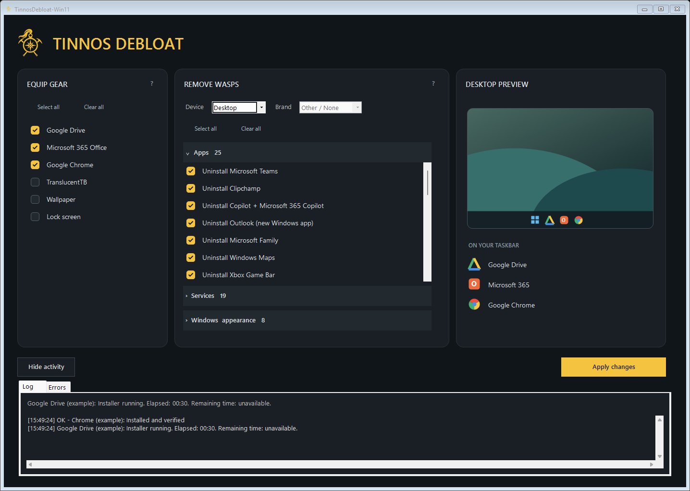
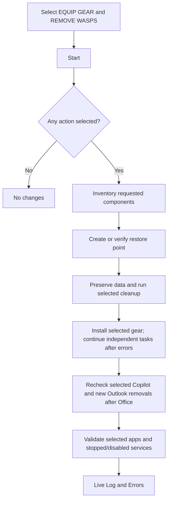

# TinnosDebloat-Win11

Windows 11 cleanup and workstation provisioning, with a restore point before deployment.

<div align="center">


</div>

<details>
<summary><strong>[Open/Close] Table of Contents</strong></summary>

- [📄 Description](#-description)
- [💡 Technologies](#-technologies)
- [⚙️ General Settings](#️-general-settings)
- [🚀 Usage](#-usage)
- [🛟 Restore Point](#-restore-point)
- [⚙️ Architecture](#️-architecture)
- [📁 Repository Structure](#-repository-structure)
- [🔎 Results](#-results)
- [Error codes](docs/ERROR_CODES.md)
- [Removal and service checklist](docs/DEBLOAT.md)
- [🔧 Build and Test](#-build-and-test)
- [🚧 Versions](#-versions)
- [🔗 References](#-references)

</details>

---

## 📄 Description

**TinnosDebloat-Win11** prepares an existing Windows 11 installation for work. It
installs selected Microsoft 365 Apps for Business, Chrome and Google Drive, removes
selected unwanted apps and disables selected services, then checks the resulting state. A
failed app is reported and skipped while the others continue. It works on the running Windows
installation; no Windows reinstall or custom image is needed.

This project was created with assistance from OpenAI Codex.

The name references the Lost City of Tinnos in *Tomb Raider III: Adventures of Lara
Croft*. We are clearing annoying things out of Windows, much like dealing with
those green flying enemies in Tinnos: the **Tinnos Wasps**. The stage's giant wasps
are described in [Stella's Tinnos walkthrough](https://tombraiders.net/stella/walks/TR3walk/A3-tinnos.html).
This is an independent utility with no affiliation with the game or its publishers.

Cleanup includes Teams, a selectable list of built-in apps and specific services,
plus desktop/taskbar preferences and dark mode. The exact scope is documented in
the [removal and service checklist](docs/DEBLOAT.md). Windows Update, Defender,
shared frameworks and personal documents are preserved.


| Component | Behavior |
| --- | --- |
| Microsoft 365 Apps for Business | Official ODT, `O365BusinessRetail`, 64-bit, Current Channel |
| Word, Excel, PowerPoint | Included in Office; verified when Office installation is selected |
| OneNote, Access, OneDrive, classic and new Outlook | Always excluded from the Office deployment; existing standalone products/documents are not force-deleted |
| Teams | Always excluded from Office; Teams removal runs only when its Uninstall entry is checked |
| New Outlook | Its Windows Store package is removed only when the corresponding Uninstall entry is checked |
| Chrome | Official Google Enterprise MSI; browser associations configured only in Install mode |
| Google Drive for desktop | Official installer; no Docs/Sheets/Slides shortcuts or requested desktop shortcut |
| Built-in apps and services | REMOVE WASPS checklist; exact packages/services, independent steps and final checks |
| Power Automate, Feedback Hub and Xbox Live | Store/desktop Power Automate selection; Feedback Hub and Xbox apps/services are covered by the existing selections |
| Dell / ASUS utilities | Specific utility selections and registered uninstallers; hardware drivers and shared core services are preserved |
| Desktop and taskbar | Hide desktop icons without deleting files; hide search and Widgets news/weather |
| Dark mode | Windows and app theme preferences for existing local user profiles |

## 💡 Technologies

| Layer | Technology |
| --- | --- |
| Desktop interface | C# / Windows Forms / .NET Framework 4.x |
| Deployment engine | Windows PowerShell 5.1, 64-bit |
| Office deployment | Microsoft's Office Deployment Tool |
| Teams removal | Official bootstrapper, Appx/MSIX servicing, supported legacy uninstallers |
| Recovery | Windows System Restore |
| Results | In-app results, mapped error codes, live log and download SHA-256 hashes |

The portable executable embeds its PowerShell files. Target devices do not need
Git, Python, a development SDK, or this source repository.

## ⚙️ General Settings

### Requirements

- Windows 11 x64, administrator access and an internet connection.
- Windows PowerShell 5.1 and .NET Framework 4.x supplied with Windows.
- Windows System Restore available and permitted by organization policy.
- Downloads need no Microsoft/Google account sign-in or Office activation.
- Using Office later requires an appropriate Microsoft 365 Apps for Business license.

### Interface selections

The screen has two always-visible lists. **Checked means execute the named
action. Unchecked means leave it alone.** Start executes the selected actions;
Details shows the live Log and Errors. There is no App Action mode selector or
Office-options panel. A small jade pendant in the upper-right corner is a visual
reference to the game's artifacts.

| List | Entries | What checking means |
| --- | --- | --- |
| **EQUIP GEAR** | Install Google Drive, Install Microsoft 365 Office, Install Google Chrome | Download the official installer and install the selected application |
| **REMOVE WASPS** | Uninstall (app), Deactivate (service), Hide (UI item), Enable dark mode | Execute exactly the action named on that line |

Office is fixed to **Business, PT-BR, 64-bit, Current Channel**, including Word,
Excel and PowerPoint. Teams, OneNote, OneDrive, Access, classic Outlook and new
Outlook are always excluded from the Office configuration. No license sign-in or
activation is attempted. Unchecking Office leaves the existing Office installation
alone. An already installed standalone OneDrive or Outlook product is not removed
merely by excluding it from a new Office deployment.

All removal entries, including Teams, can be unchecked. No selected actions means
Start performs no deployment. The supplied defaults select the built-in app
removals, common background-service changes, desktop/taskbar settings and dark
mode. Higher impact services such as BitLocker management, biometrics, Smart Card,
Server/SMB, Remote Desktop Services and the Remote Desktop Connection client start
unchecked. Read [the checklist reference](docs/DEBLOAT.md) before selecting them.
Dell SupportAssist, Digital Delivery, Customer Connect and ASUS GIFTBOX are included
in the defaults. Dell Optimizer, recovery helpers, MyASUS and Armoury Crate require
explicit selection because they can affect device settings or OEM recovery.
Selections are saved in the run's working configuration as `InstallItems` and `RemoveItems` IDs;
the supplied `config.example.json` shows the same defaults as the interface.



### Official downloads

ODT is resolved automatically from [Microsoft Download Center, product 49117](https://www.microsoft.com/en-us/download/details.aspx?id=49117).
There is no installer picker or configurable mirror. The engine extracts the
official archive and verifies Microsoft's signature on both the archive and
`setup.exe`. If the page cannot be reached (including a `www.microsoft.com` DNS
failure), it tries the official `download.microsoft.com` archive link verified
for this release on 2026-11-04. The fallback is ODT 16.0.20430.20146; page-based
discovery is preferred for the current version. Neither source requires sign-in.
An invalid signature is rejected.

Installer transfers try PowerShell `Invoke-WebRequest`, then Windows' inbox
`curl.exe`, with HTTPS-only transfers, timeouts, nonempty-file checks and vendor
signature verification. Failed or unsigned responses never become final installer
files. A different downloader does not repair an unavailable internet connection
or broken DNS; those failures remain explicit in Details and the next app is tried.

The [Teams bootstrapper](https://go.microsoft.com/fwlink/?linkid=2243204&clcid=0x409)
is used exclusively with uninstall arguments `-x -m`. Chrome and Drive come from
Google's official `dl.google.com` endpoints and must pass Google signature checks.
ODT downloads Office files before installation. No tools are taken from third-party
script collections or unofficial mirrors.

The ODT archive and its extracted `setup.exe` must both pass Microsoft signature
checks. Executable validation no longer relies on version-resource descriptions
or `OriginalFilename`, which vary between releases and caused false `TNO-307`
failures. Office still runs through ODT `/download` and `/configure`.

Drive uses Google's documented `--gsuite_shortcuts=false` option and omits
`--desktop_shortcut`. These options prevent creation of extra shortcuts on this
installation; they do not uninstall the Docs/Sheets/Slides web services or delete
shortcuts left by earlier installations. Hiding desktop icons leaves those files intact.

---

## 🚀 Usage

### Portable application

1. Copy [tinnosdebloat-win11.exe](tinnosdebloat-win11.exe?raw=true) to the target device.
2. Open it and approve the Windows administrator request.
3. Select what to install under EQUIP GEAR and what to uninstall/deactivate under REMOVE WASPS.
4. Select **Start**. Only selected actions run; Office language is always PT-BR.
5. Select **Details** for the live Log and Errors tabs. The status line follows the current task.

Opening the app does not deploy anything. Closing is blocked while an operation
is running, so installers are not interrupted by closing the window.

Version 2.3.1 fixes console-encoding initialization on the GUI startup path. A
normal Windows Explorer launch has no console; the window no longer depends on
one. If window creation fails, an English `TNO-905` dialog shows the exception
instead of silently failing. Replace older copies on USB drives or target devices
with the rebuilt executable from this version.

The executable is unsigned. Sign release binaries and scripts with your normal
publisher certificate where managed distribution requires it. This build has been
compiled and tested without a live deployment; validate on Windows 11 test devices
before broad rollout.

### Unattended execution

From an already elevated management process:

```powershell
$run = Start-Process .\tinnosdebloat-win11.exe `
    -ArgumentList '--mode Deploy' -Wait -PassThru
$run.ExitCode
```

Defaults are embedded. For administrator customization, copy `config.example.json`:

```powershell
Start-Process .\tinnosdebloat-win11.exe `
    -ArgumentList '--mode Deploy --config "C:\Deployment\config.json"' `
    -Wait -PassThru
```

Modes are `Audit`, `Plan` and `Deploy`. An optional `--output <folder>` changes the
working-file location. These advanced modes remain available through the command
line; the GUI has no Audit button. Plan generates XML without deploying software.
The Business product and `"Languages": ["pt-br"]` are fixed; other languages,
unknown fields, license keys and custom installer URLs are rejected.

`InstallItems` accepts `Office`, `Chrome` and `GoogleDrive`; an empty array skips
all installs. `RemoveItems` accepts the IDs in `debloat-catalog.json`; an empty
array skips all removals and preferences. Both empty arrays request no changes.
The GUI and default configuration install selected apps. The legacy Office flags
`IncludeAccess`, `ExcludeOneDrive` and `ExcludeNewOutlook` are no longer accepted;
use the updated sample configuration.

Advanced command-line users can still set `"AppMode": "Download"` explicitly;
the default is `Install`. Office download mode runs ODT `/download` and verifies the media;
it never runs `/configure`. Office data is saved under `OfficeMedia`, and Chrome
and Drive installers are saved beside the generated Office XML. If moving Office
media to another folder or device for later installation, update the XML's absolute
`SourcePath` to the copied `OfficeMedia` folder.

### Execution policy and activation

The launcher and employee cleanup helper use `-ExecutionPolicy Bypass` only for
their own PowerShell processes. They do not change CurrentUser or LocalMachine
execution policy. **Group Policy MachinePolicy/UserPolicy still take precedence**.
A centrally blocked or AllSigned-only deployment requires organization-approved
script signing or management configuration. The tool reports the block.

The deployment never signs in, requests credentials, activates Office or queries
the employee's license. Details shows activation as **Deferred**, which does not
block downloads or installation. There is no key, password or licensing bypass.
An employee may activate Office later using their licensed account. The separate
`Check-OfficeActivation.ps1` remains an optional manual diagnostic; deployment
does not invoke it.

## 🛟 Restore Point

**Start** attempts to create and verify a Windows restore point before application
removal, policy changes or installation. System protection is enabled on the
Windows system drive using the supported cmdlet when policy permits it.
Policy-disabled restore is reported and is not overridden.

Windows normally limits `Checkpoint-Computer` to one point per day. If Windows
explicitly throttles creation, a verified point less than 24 hours old can be
used, recording `ReusedRecent`, its sequence and timestamp. That older point does
not represent the exact state immediately before this run. A fresh point is
reported as `Created`. If neither is available, selected system changes are skipped
and the error appears immediately. There is no automatic download fallback for an
installation request; resolve the prerequisite and retry. Empty selections do not
create a restore point.

Restore points are not backups of personal documents. Before Teams uninstall,
known local Teams data stores are separately copied to an administrator/SYSTEM-only
`PreservedTeamsData` directory. Locked data, unreadable profiles, running Teams and
redirected data stores block removal. No recursive deletion of Microsoft folders,
synchronized files, Desktop documents or Downloads is performed.
Selected Store apps likewise require a protected `PreservedAppData` copy before
uninstallation. Unreadable or redirected app data blocks that app's removal while
other selections continue. Detached profile containers must be attached to be covered.

## ⚙️ Architecture



Matching Office installations are skipped. Product, bitness, apps, languages,
channel and exclusions must all match. Incompatible Office installations and
central update-policy conflicts require administrator remediation. Documents and
applications are not force-closed.

Matching-install checks apply only to Install mode. Download mode can prepare
Office media regardless of the installed Office edition. If Teams removal is checked,
pending Teams cleanup blocks Office installation; Chrome, Drive and independent cleanup selections can
continue. Downloading never proves Teams is absent. Restore-point and central
policy prerequisites remain enforced for the affected operations.

Classic Teams profiles use limited interactive tasks named
`TinnosDebloat-Win11-RemoveTeams-<SID>`, without saved credentials. Offline profiles
may need a logon before cleanup finishes. Rerun Start afterward to continue.
Registered tasks or zero uninstall exit codes do not prove removal. Inventory
covers nonspecial local Windows profiles and all-user packages; detached or
remote profile containers require an audit when attached.

GPO/Intune settings are preserved and conflicts reported. The Office prevention
policy covers the Office installation/update path. Separate Intune, Store or
tenant app assignments must also be reviewed centrally. Chrome's supported default
policy applies at sign-in; existing `UserChoice` hashes are never modified.

## 📁 Repository Structure

```text
tinnosdebloat-win11/
├── tinnosdebloat-win11.exe       # Portable application
├── tinnosdebloat-win11.exe.sha256
├── Build.ps1                   # Uses Windows' C# compiler
├── Invoke-Provisioning.ps1
├── Invoke-UserCleanup.ps1
├── Check-OfficeActivation.ps1
├── Provisioning.psm1
├── config.example.json
├── error-codes.json             # Shared error catalog
├── debloat-catalog.json         # Exact removals, services and preferences
├── src/
│   ├── Program.cs
│   └── app.manifest
├── tests/
│   └── Run-Tests.ps1
├── docs/
│   ├── interface.png
│   ├── interface-details.png
│   ├── DEBLOAT.md
│   └── ERROR_CODES.md
└── README.md
```

Only the `.exe` is needed on target devices. Source and tests remain in the
repository for review and rebuilding.

## 🔎 Results

**Details** displays the current run inside the application:

- **Log:** live tasks, elapsed installer time, explicit success messages and a final verification summary.
- **Errors:** errors, warnings and pending actions appear as they happen, with `TNO-xxx` codes, recovery actions and native exit codes when available.

The separate Results tab was removed. The status beneath Details follows the
same live events as the Log. An error is retained in both tabs, with duplicate
final error entries suppressed. Each independent task is attempted even after an
earlier failure; dependent or unsafe operations are skipped with a reason.

Installers emit a heartbeat about every five seconds while their process is
running. Drive is checked again after its installer exits before reporting success.
These silent installers do not expose a reliable remaining-time estimate or their
internal task list. The tool shows the current operation and actual elapsed time,
with **Remaining time: unavailable**, instead of an invented percentage or countdown.

Results and the live log stay in memory and are lost when the application closes.
Application diagnostics and PowerShell use English (`en-US`), independently of
Office's fixed PT-BR language. The launcher reads both output streams as UTF-8
to preserve accented paths and user names. Windows/vendor components can still
return messages in their installed language; those original diagnostics are
preserved alongside the English error title and recovery action.
The tool does not write `report.html`, `report.json` or `launcher.log`.
For troubleshooting, use the [error-code reference](docs/ERROR_CODES.md).
For example, `TNO-300` identifies DNS resolution failure and `TNO-400` identifies
a vendor installer/uninstaller failure; the native exit code gives further detail.

Downloaded installers, Office media/XML, extracted scripts, configuration and
pending cleanup-task dependencies still need working files under
`C:\ProgramData\TinnosDebloat-Win11\Runs\<run-id>\Work` and its parent run directory.
Protected `PreservedTeamsData` and `PreservedAppData` are retained when user data needs preservation.
Windows and vendor tools may create their own system logs. Reports left by older
versions are not automatically deleted.

| Exit code | Result |
| --- | --- |
| `0` | Passed audit/deployment, or generated plan; inspect mode and checks |
| `1` | Failure, unreadable inventory or policy conflict |
| `2` | Cleanup checks passed, but some app operations failed or were skipped (`CompletedWithIssues`) |
| `3010` | Pending reboot, profile logon, restore availability or retry; read Details |

In-memory results include restore-point outcomes, before/after inventory, policies, remaining
Teams components, individual app outcomes and deferred activation. Inaccessible
relevant inventory prevents a claim of complete removal. Complete provisioning
does not imply that the employee's Office account is activated.

The final Log summary distinguishes `Downloaded`, `Installed`, `AlreadyInstalled`,
`Removed`, `Disabled`, `Configured`, `NotPresent` and `Failed`.
Required cleanup checks are separated from app observations.
Downloading an installer never reports its app as installed. Failed optional apps
produce `CompletedWithIssues` only when the required selected cleanup checks pass;
remaining selected Teams components, unreadable relevant profiles or applicable
policy conflicts cannot be hidden by skipping apps. Unchecked components are not
certified as absent and do not create failures for unrelated selected tasks.

Keep working directories while tasks are pending. They hold task dependencies and
may contain preserved Teams data/authentication material; apply your retention
rules. Never commit device reports or preserved data to GitHub. `.gitignore`
excludes runtime paths, local configuration and logs.

## 🔧 Build and Test

No NuGet packages or third-party build tools are required:

```powershell
.\Build.ps1
.\tests\Run-Tests.ps1
```

Tests inspect embedded sources, manifest, arguments, configuration, XML, absence
criteria, restore-point failures and operation ordering using temporary files and
mocks. They do not install software, change execution policies or create restore
points. The preview is rendered from the real form without starting deployment.

## 🚧 Versions

<details>
<summary><strong>[See/Hide] Version 2.4.0 — Equip gear, remove wasps</strong></summary>

- Two explicit action lists replace App Action and Office options; unchecked actions stay untouched.
- Fixed Office exclusions for OneDrive, Access and both Outlook versions; Word, Excel, PowerPoint and OneNote remain included.
- Added Microsoft 365 Copilot's OfficeHub package to the selected Copilot removal and rechecks after Office installation.
- Waits for services to stop before disabling; final validation still requires stopped and Disabled.
- Small jade pendant reference, updated previews, scoped validation and configuration tests.

</details>

<details>
<summary><strong>[See/Hide] Version 2.3.2 — Remote Desktop Connection</strong></summary>

- Added a separate, opt-in removal for the built-in Remote Desktop Connection client (`mstsc`).
- Uses the Microsoft uninstaller on Windows 11 23H2+, with its restart prompt visible and no automatic-restart switch.
- Protects active client sessions and saved RDP files; reports pending removal until client binaries are absent.
- Remote Desktop Services (`TermService`) remains a separate checklist selection.

</details>

<details>
<summary><strong>[See/Hide] Version 2.3.1 — Startup and OEM utilities</strong></summary>

- GUI startup no longer sets console encoding; startup exceptions display a visible error dialog.
- Added a GUI-subsystem regression fixture with no console handles and a forced startup failure.
- Added Power Automate Store/desktop removal; Feedback Hub and Xbox Live remain covered.
- Added exact Dell/ASUS utility selections with publisher checks, registered MSI or signed quiet uninstallers, and final verification.
- Unsupported uninstallers and per-user desktop products receive manual instructions; Armoury Crate uses the official ASUS tool workflow.
- Updated documentation, error codes, previews and the portable executable.

</details>

<details>
<summary><strong>[See/Hide] Version 2.3.0 — Selectable cleanup and live activity</strong></summary>

- Fixed false ODT setup validation failures while retaining signed official tools.
- Expandable app/service checklist, protected app-data copies and all-user/provisioning verification.
- Services from the requested Services console list, with higher impact choices unchecked by default.
- Dark mode, hidden desktop icons, and hidden taskbar search/news/weather options.
- Drive-only shortcut configuration and verified installation outcomes.
- Live status, immediate errors, explicit success messages and elapsed installer time.
- Log and Errors replace the separate Results screen; independent tasks continue after failures.
- Updated error codes, tests, executable and interface previews.

</details>

<details>
<summary><strong>[See/Hide] Version 2.2.0 — Results inside the app</strong></summary>

- Fixed PT-BR Office configuration and removed language selectors.
- Only Start and Details action buttons, with Results, Errors and Log tabs.
- In-memory results replace saved deployment reports and launcher logs.
- Shared error catalog with recovery actions and native installer exit codes.
- Updated interface screenshot, tests and Tinnos Wasps naming reference.

</details>

<details>
<summary><strong>[See/Hide] Version 2.1.0 — Download and continue</strong></summary>

- Download-only default with optional app installation.
- Grouped action, language and Office settings; explicit mode choices and a clear primary action.
- Independent Office, Chrome and Drive operations; failures are skipped and reported.
- Official Microsoft archive fallback for unavailable Download Center discovery.
- PowerShell transfers with a Windows curl fallback and vendor signature checks.
- No automatic sign-in, activation or license-status query.
- Clear app outcomes and `CompletedWithIssues` status.

</details>

<details>
<summary><strong>[See/Hide] Version 2.0.0 — Tinnos</strong></summary>

- Independent project identity and portable executable.
- Minimal selection buttons with expandable execution details.
- Microsoft 365 Apps for Business and automatic official ODT downloads.
- Restore point verified before deployment changes.
- Process-scoped PowerShell setting for packaged scripts.
- Teams exclusion, data preservation, all-user checks and pending-action reports.

</details>

## 🔗 References

- [Microsoft Office Deployment Tool](https://www.microsoft.com/en-us/download/details.aspx?id=49117)
- [ODT XML configuration](https://learn.microsoft.com/en-us/microsoft-365-apps/deploy/office-deployment-tool-configuration-options)
- [Teams removal](https://learn.microsoft.com/en-us/microsoftteams/teams-client-uninstall)
- [Prevent Teams installation with Office](https://learn.microsoft.com/en-us/microsoft-365-apps/deploy/teams-install)
- [Checkpoint-Computer limits](https://learn.microsoft.com/en-us/powershell/module/microsoft.powershell.management/checkpoint-computer?view=powershell-5.1)
- [PowerShell execution-policy precedence](https://learn.microsoft.com/en-us/powershell/module/microsoft.powershell.core/about/about_execution_policies?view=powershell-5.1)
- [Microsoft 365 activation diagnostics](https://learn.microsoft.com/en-us/microsoft-365-apps/licensing-activation/vnextdiag)
- [Google Drive deployment](https://knowledge.workspace.google.com/admin/drive/set-up-drive-for-desktop-for-your-organization)
- [Windows default associations](https://learn.microsoft.com/en-us/windows/client-management/mdm/policy-csp-applicationdefaults)
- [All-user Appx removal](https://learn.microsoft.com/en-us/powershell/module/appx/remove-appxpackage?view=windows-11)
- [Hide desktop items policy](https://learn.microsoft.com/en-us/windows/client-management/mdm/policy-csp-admx-desktop#nodesktop)
- [Taskbar search policy](https://learn.microsoft.com/en-us/windows/client-management/mdm/policy-csp-search)
- [Widgets news/weather policy](https://learn.microsoft.com/en-us/windows/client-management/mdm/policy-csp-newsandinterests)

---

Developed by [Vitória Peçanha](https://github.com/vitoriape).

## Version 2.5.0 - Cleanup and appearance fixes

- Desktop icons, search and Widgets use each existing user's preference hive,
  including Windows Home and pre-24H2 builds. Effective conflicting policies are
  reported and preserved. Final verification re-reads the preferences.
- Dark mode, Yellow gold / Ouro Amarelo (`#FFB900`) accent and a solid Moss / Musgo
  (`#486860`) desktop background are selectable defaults. No wallpaper downloads
  or desktop file deletions are involved. Current-user refresh is requested;
  other active accounts may need sign-out/sign-in.
- Added Microsoft 365 companion apps (`Microsoft.M365Companions`), OneDrive,
  McAfee WebAdvisor and Dell Connected Service Delivery/Subagent. Expanded exact
  SupportAssist/Optimizer names; Optimizer and Remote Desktop Connection removal
  are now checked by default. Drivers and saved documents are preserved.
- Native vendor uninstallers can display their registered confirmation prompt if
  no supported quiet command exists. Remaining products are reported, not hidden.
- Per-user OneDrive uninstallers run through owning-user limited-token tasks,
  never as the administrator. Sign in and run Tinnos again to verify completion.
  OneDrive folders, online-only files and cloud contents are not deleted; files
  that are online-only remain accessible through the user's OneDrive account.
- Office installs Word, Excel and PowerPoint; OneNote is now explicitly excluded
  alongside Teams, OneDrive, Access and both Outlook variants. Existing matching
  Office is reconfigured when its exclusion list differs. No notebooks are deleted.

Use the rebuilt `tinnosdebloat-win11.exe` and its checksum from this repository;
older downloaded executables contain older embedded scripts and catalogs.

## Interface and cleanup update (2.6)

The supplied Golden Compass Raider emblem appears in the header, window, taskbar and executable. Source artwork and the multi-resolution Windows icon live in `assets/`.

REMOVE WASPS now starts in Desktop mode, excluding Dell and ASUS actions. Laptop mode enables Other / None, ASUS and Dell. Choosing a vendor checks its catalog utilities, including MyASUS and Dell recovery helpers; review the list before Start because these can affect battery settings and recovery. Only that vendor is included in the generated configuration. Unknown products and drivers are not removed by broad name matching. Armoury Crate still reports the official complete uninstall-tool requirement rather than claiming a partial removal succeeded. CLI configurations continue to use explicit RemoveItems and are independent of GUI filtering.

Windows Search has separate indexing and full Search UI actions. Full blocking uses Microsoft's DisableSearch policy, with indexing stopped separately. It requires updated Windows 11 Pro/Enterprise/Education 24H2 (KB5062660, build 26100.4770) or newer and a restart. Unsupported editions/builds and conflicting existing policies are reported as errors. Verification proves the policy value, not that the currently running shell has reloaded it. After restarting, confirm Win+S and Start typing no longer open Search. Protected Windows binaries are preserved.

Policy reference: https://learn.microsoft.com/en-us/windows/client-management/mdm/policy-csp-search#disablesearch
To restore Search UI, remove the DisableSearch value at HKLM\SOFTWARE\Policies\Microsoft\Windows\Windows Search and restart (or change the centrally assigned policy). To restore indexing, set WSearch back to its prior startup mode and start the service.

Bing and Media Player cleanup: `Bing` removes the exact `Microsoft.BingSearch` app package; `MediaPlayer` removes `Microsoft.ZuneMusic` (Reprodutor Multimidia / modern Media Player, formerly Groove). Both are checked by default and included in the example CLI configuration. Movies & TV (`Microsoft.ZuneVideo`) remains a separate selection. These use existing all-user and provisioned-package removal with app-data backup and final absence verification. Media files outside app data are not targeted. Bing websites, Edge search-engine preferences and legacy Windows Media Player are separate from these Store apps.

Optional service cleanup: ASUS laptop mode exposes System Diagnosis, System Analysis, Switch, Software Manager, Optimization and App Service disable actions. AMD External Events Utility and AMD Crash Defender Service are available independently of manufacturer. Cryptographic Services (`CryptSvc`, Servicos de Criptografia) is also optional; this is not disk encryption or BitLocker. All nine actions remain unchecked, including after choosing ASUS, and are excluded from the example CLI defaults. The help button explains hotkey, battery, display, GPU recovery, Windows Update and signature-verification impacts. Existing service handling respects managed policy, does not force-stop dependencies, reports missing services as NotPresent, and verifies both stopped state and Disabled startup. Previous startup/state is retained in the operation result for manual restoration through services.msc. These changes do not disable any services on the development PC.

## Install and personalization options (2.7)

- **Install TranslucentTB** is an unchecked EQUIP GEAR option. Installation uses Microsoft's signed App Installer (`winget.exe`) and the exact Microsoft Store product `9PF4KZ2VN4W9`, then verifies the installed package identity and publisher for the account running this app. App Installer, Store access and applicable organization permissions are required. No application is downloaded from similarly named third-party websites. CLI `InstallItems` accepts `TranslucentTB`. Download mode saves the official GitHub `.appinstaller` bootstrap manifest; it is not offline application media and is not installed during download-only runs.
- **Wallpaper** and **Lock screen** are Equip Gear checklist entries. Checking Wallpaper opens the Windows image picker, then asks whether to use the same image on the lock screen. Check Lock screen separately to choose a different image. Unchecking clears the pending image choice (including a linked lock-screen image); rechecking opens the picker again. Cancelling the picker leaves the item unchecked. The desktop preview displays the chosen wallpaper; changes apply only after Apply changes. The worker validates/decodes the files and retains JPEG copies in the protected run's `Personalization` folder so deleting the source does not break the setting. Keep that run folder while using its wallpaper. These image choices apply to the account running the elevated app, not every local profile. Existing managed image restrictions are preserved and reported. A custom wallpaper takes precedence over the selected Moss solid background for the run. The lock screen uses the Windows LockScreen API and compares its image stream hash to the copied image; an unverified result is reported as an error. CLI configs can specify `WallpaperPath` and `LockScreenPath`; omit them or use empty strings to leave images unchanged. Download-only mode does not apply image changes.
- **Hide Start menu content** is an unchecked REMOVE WASPS option (`EmptyStartMenu`). It applies an empty pinned-app policy and hides Recommended and All apps for existing non-special local profiles; it does not uninstall programs or delete Start-menu shortcuts. It requires updated Windows 11 Pro/Enterprise/Education 24H2 with KB5062660 or later. Conflicting local/central policies and unsupported editions are reported rather than overridden. Sign out or restart after applying. Verification checks the policy/preferences, not the running shell's visual state. The text **Todas as seções Iniciar estão desativadas** is generated by Windows, and its wording/appearance depends on the installed Start menu version; older layouts may show an empty pinned area instead. Account and power controls remain available. To undo the Start policy, remove the values `ConfigureStartPins` and `HideRecommendedSection` under each affected user's `Software\Policies\Microsoft\Windows\Explorer`, and `NoStartMenuMorePrograms` under `Software\Microsoft\Windows\CurrentVersion\Policies\Explorer`, then sign out. This releases the policies but does not reconstruct your previous pin arrangement.

Official references:
- https://github.com/TranslucentTB/TranslucentTB
- https://learn.microsoft.com/en-us/windows/client-management/mdm/policy-csp-start
- https://learn.microsoft.com/en-us/uwp/api/windows.system.userprofile.lockscreen.setimagefileasync

Development checks use mocked installation, image-setting and policy operations. The live checks only downloaded the official TranslucentTB manifest and read the existing lock-screen stream; no apps, images, Start settings or services were changed on the development PC.


## Interface refresh (2.8)

The main window has three cards: **Equip Gear**, **Remove Wasps**, and a live **Desktop Preview**. The logo aligns with **TINNOS DEBLOAT**. The idle status line, unchanged-image labels, separate image buttons and header help button have been removed. Progress and errors remain available through **Activity** during and after a run.

Both action columns have **Select all** and **Clear all**. Equip Gear includes the program choices plus Wallpaper and Lock screen; selecting all runs the same image-picker/confirmation flow, while cancellation keeps an image unchecked. Image entries never enter `InstallItems`. Remove Wasps groups actions under expandable **Apps**, **Services**, **Windows & appearance**, and **Manufacturer apps**. Collapsing a section preserves its checked actions. Bulk selection applies to every available section, including collapsed sections, but never includes another manufacturer's hidden actions. Select all also selects optional/high-impact service and policy actions; review the sections before applying changes. Switching device or manufacturer retains your selections for when that profile is shown again, but only currently available actions are serialized.

The desktop preview shows the selected wallpaper and representative taskbar icons for the chosen programs, with a translucent-taskbar illustration when TranslucentTB is checked. It is a preview of the plan, not a live capture, an installation result, or a request to pin programs on the real taskbar. Checkboxes use custom drawing while retaining keyboard and accessibility behavior. Long cleanup labels can be read in full by hovering over the row. No image, installation or cleanup changes happen while selecting or previewing options.
