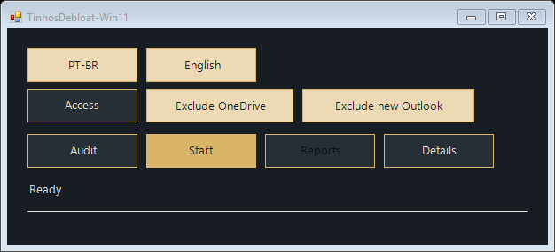
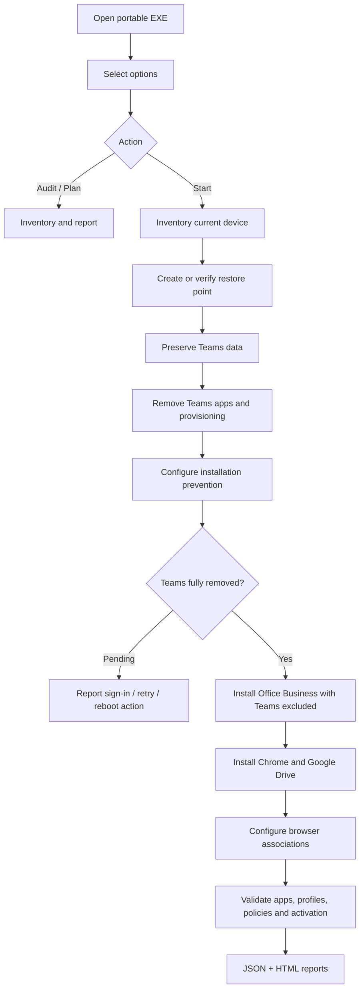

# TinnosDebloat-Win11

Windows 11 cleanup and workstation provisioning, with a restore point before deployment.

<div align="center">


</div>

<details>
<summary><strong>[Open/Close] Table of Contents</strong></summary>

- [📄 Description](#-description)
- [💡 Technologies](#-technologies)
- [⚙️ General Settings](#️-general-settings)
- [🚀 Usage](#-usage)
- [🛟 Restore Point](#-restore-point)
- [⚙️ Architecture](#️-architecture)
- [📁 Repository Structure](#-repository-structure)
- [🔎 Reports](#-reports)
- [🔧 Build and Test](#-build-and-test)
- [🚧 Versions](#-versions)
- [🔗 References](#-references)

</details>

---

## 📄 Description

**TinnosDebloat-Win11** prepares an existing Windows 11 installation for work. It
removes Microsoft Teams, installs Microsoft 365 Apps for Business, Chrome and
Google Drive, and checks the resulting state. It works on the running Windows
installation; no Windows reinstall or custom image is needed.

This project was created with assistance from OpenAI Codex.

The name references Tinnos in *Tomb Raider III: Adventures of Lara Croft*. This is an
independent utility with no affiliation with the game or its publishers.

The current cleanup scope is Teams and its installation paths. This tool does
not remove an arbitrary list of Windows apps, disable Windows Update or Defender,
or erase personal documents.



| Component | Behavior |
| --- | --- |
| Microsoft 365 Apps for Business | Official ODT, `O365BusinessRetail`, 64-bit, Current Channel |
| Word, Excel, PowerPoint, classic Outlook, OneNote | Required and verified after deployment |
| Access | Optional selection |
| Teams | Always excluded; new, classic, personal, machine-wide and provisioned variants checked |
| OneDrive | Excluded from Office when selected; existing standalone OneDrive and its documents are preserved |
| New Outlook | Excluded from Office when selected; classic Outlook remains required |
| Chrome | Official Google Enterprise MSI; supported browser association configuration |
| Google Drive for desktop | Official Google installer; silent installation |

## 💡 Technologies

| Layer | Technology |
| --- | --- |
| Desktop interface | C# / Windows Forms / .NET Framework 4.x |
| Deployment engine | Windows PowerShell 5.1, 64-bit |
| Office deployment | Microsoft's Office Deployment Tool |
| Teams removal | Official bootstrapper, Appx/MSIX servicing, supported legacy uninstallers |
| Recovery | Windows System Restore |
| Results | JSON, HTML, installer logs, download SHA-256 hashes |

The portable executable embeds its PowerShell files. Target devices do not need
Git, Python, a development SDK, or this source repository.

## ⚙️ General Settings

### Requirements

- Windows 11 x64, administrator access and an internet connection.
- Windows PowerShell 5.1 and .NET Framework 4.x supplied with Windows.
- Windows System Restore available and permitted by organization policy.
- A valid **Microsoft 365 Apps for Business** subscription for Office activation.

### Interface selections

| Button | Default | Meaning |
| --- | --- | --- |
| PT-BR | Selected | Install Portuguese (Brazil) Office language |
| English | Selected | Install English Office language |
| Access | Off | Include Microsoft Access |
| Exclude OneDrive | Selected | Exclude OneDrive from the Office deployment |
| Exclude new Outlook | Selected | Exclude the new Outlook app from Office |

Gold buttons are selected. Choose at least one language. The Office edition,
Teams exclusion, 64-bit architecture and restore-point step are automatic.
The GUI uses Current Channel; administrators can select another supported update
channel in JSON for command-line deployment.

### Official downloads

ODT is resolved automatically from [Microsoft Download Center, product 49117](https://www.microsoft.com/en-us/download/details.aspx?id=49117).
There is no installer picker or configurable mirror. The engine extracts the
official archive and verifies Microsoft's signature on both the archive and
`setup.exe`. A changed page layout or invalid signature causes an explicit failure.

The [Teams bootstrapper](https://go.microsoft.com/fwlink/?linkid=2243204&clcid=0x409)
is used exclusively with uninstall arguments `-x -m`. Chrome and Drive come from
Google's official `dl.google.com` endpoints and must pass Google signature checks.
ODT downloads Office files before installation. No tools are taken from third-party
script collections or unofficial mirrors.

---

## 🚀 Usage

### Portable application

1. Copy [tinnosdebloat-win11.exe](tinnosdebloat-win11.exe?raw=true) to the target device.
2. Open it and approve the Windows administrator request.
3. Select languages and optional Office components.
4. Use **Audit** to inspect the device, or **Start** to apply the deployment.
5. Open **Reports** for results. **Details** expands the execution log.

Opening the app does not deploy anything. Closing is blocked while an operation
is running, so installers are not interrupted by closing the window.

The executable is unsigned. Sign release binaries and scripts with your normal
publisher certificate where managed distribution requires it. This build has been
compiled and tested without a live deployment; validate on Windows 11 test devices
before broad rollout.

### Unattended execution

From an already elevated management process:

```powershell
$run = Start-Process .\tinnosdebloat-win11.exe `
    -ArgumentList '--mode Deploy' -Wait -PassThru
$run.ExitCode
```

Defaults are embedded. For administrator customization, copy `config.example.json`:

```powershell
Start-Process .\tinnosdebloat-win11.exe `
    -ArgumentList '--mode Deploy --config "C:\Deployment\config.json"' `
    -Wait -PassThru
```

Modes are `Audit`, `Plan` and `Deploy`. An optional `--output <folder>` changes the
report location. Plan generates XML without deploying software. The Business
product is fixed; unknown fields, license keys and custom installer URLs are rejected.

### Execution policy and activation

The launcher and employee cleanup helper use `-ExecutionPolicy Bypass` only for
their own PowerShell processes. They do not change CurrentUser or LocalMachine
execution policy. **Group Policy MachinePolicy/UserPolicy still take precedence**.
A centrally blocked or AllSigned-only deployment requires organization-approved
script signing or management configuration. The tool reports the block.

The employee activates Office with their licensed Microsoft 365 account. No keys,
passwords or licensing bypasses are included. Reports run `vnextdiag.ps1 -action list`
read-only and distinguish `Licensed`, `NotLicensed` and `Unknown`. An administrator
or SYSTEM result does not prove employee activation. The extracted
`Check-OfficeActivation.ps1` can check in the employee's account using permitted
PowerShell execution settings.

## 🛟 Restore Point

**Start** attempts to create and verify a Windows restore point before application
removal, policy changes or installation. System protection is enabled on the
Windows system drive using the supported cmdlet when policy permits it.
Policy-disabled restore is reported and is not overridden.

Windows normally limits `Checkpoint-Computer` to one point per day. If Windows
explicitly throttles creation, a verified point less than 24 hours old can be
used, recording `ReusedRecent`, its sequence and timestamp. That older point does
not represent the exact state immediately before this run. A fresh point is
reported as `Created`. If neither is available, deployment stops before removing
or installing applications and reports the pending action.

Restore points are not backups of personal documents. Before Teams uninstall,
known local Teams data stores are separately copied to an administrator/SYSTEM-only
`PreservedTeamsData` directory. Locked data, unreadable profiles, running Teams and
redirected data stores block removal. No recursive deletion of Microsoft folders,
synchronized files, Desktop documents or Downloads is performed.

## ⚙️ Architecture



Matching Office installations are skipped. Product, bitness, apps, languages,
channel and exclusions must all match. Incompatible Office installations and
central update-policy conflicts require administrator remediation. Documents and
applications are not force-closed.

Classic Teams profiles use limited interactive tasks named
`TinnosDebloat-Win11-RemoveTeams-<SID>`, without saved credentials. Offline profiles
may need a logon before cleanup finishes. Rerun Start afterward to continue.
Registered tasks or zero uninstall exit codes do not prove removal. Inventory
covers nonspecial local Windows profiles and all-user packages; detached or
remote profile containers require an audit when attached.

GPO/Intune settings are preserved and conflicts reported. The Office prevention
policy covers the Office installation/update path. Separate Intune, Store or
tenant app assignments must also be reviewed centrally. Chrome's supported default
policy applies at sign-in; existing `UserChoice` hashes are never modified.

## 📁 Repository Structure

```text
tinnosdebloat-win11/
├── tinnosdebloat-win11.exe       # Portable application
├── tinnosdebloat-win11.exe.sha256
├── Build.ps1                   # Uses Windows' C# compiler
├── Invoke-Provisioning.ps1
├── Invoke-UserCleanup.ps1
├── Check-OfficeActivation.ps1
├── Provisioning.psm1
├── config.example.json
├── src/
│   ├── Program.cs
│   └── app.manifest
├── tests/
│   └── Run-Tests.ps1
├── docs/
│   └── interface.png
└── README.md
```

Only the `.exe` is needed on target devices. Source and tests remain in the
repository for review and rebuilding.

## 🔎 Reports

Default runtime location:

```text
C:\ProgramData\TinnosDebloat-Win11\Runs\<run-id>\
├── launcher.log
├── config.json
├── extracted PowerShell files
└── Reports\<deployment-id>\
    ├── report.html
    ├── report.json
    ├── office-configuration.xml
    ├── installer logs and download evidence
    └── PreservedTeamsData\     # When data required preservation
```

| Exit code | Result |
| --- | --- |
| `0` | Passed audit/deployment, or generated plan; inspect mode and checks |
| `1` | Failure, unreadable inventory or policy conflict |
| `3010` | Pending reboot, profile logon, restore availability or retry; read the report |

Reports include restore-point outcomes, before/after inventory, policies, remaining
Teams components, application checks and account-scoped activation. Inaccessible
relevant inventory prevents a claim of complete removal. Complete provisioning
does not imply that the employee's Office account is activated.

Keep runtime directories while tasks are pending. They hold task dependencies and
may contain preserved Teams data/authentication material; apply your retention
rules. Never commit device reports or preserved data to GitHub. `.gitignore`
excludes runtime paths, local configuration and logs.

## 🔧 Build and Test

No NuGet packages or third-party build tools are required:

```powershell
.\Build.ps1
.\tests\Run-Tests.ps1
```

Tests inspect embedded sources, manifest, arguments, configuration, XML, absence
criteria, restore-point failures and operation ordering using temporary files and
mocks. They do not install software, change execution policies or create restore
points. The preview is rendered from the real form without starting deployment.

## 🚧 Versions

<details>
<summary><strong>[See/Hide] Version 2.0.0 — Tinnos</strong></summary>

- Independent project identity and portable executable.
- Minimal selection buttons with expandable execution details.
- Microsoft 365 Apps for Business and automatic official ODT downloads.
- Restore point verified before deployment changes.
- Process-scoped PowerShell setting for packaged scripts.
- Teams exclusion, data preservation, all-user checks and pending-action reports.

</details>

## 🔗 References

- [Microsoft Office Deployment Tool](https://www.microsoft.com/en-us/download/details.aspx?id=49117)
- [ODT XML configuration](https://learn.microsoft.com/en-us/microsoft-365-apps/deploy/office-deployment-tool-configuration-options)
- [Teams removal](https://learn.microsoft.com/en-us/microsoftteams/teams-client-uninstall)
- [Prevent Teams installation with Office](https://learn.microsoft.com/en-us/microsoft-365-apps/deploy/teams-install)
- [Checkpoint-Computer limits](https://learn.microsoft.com/en-us/powershell/module/microsoft.powershell.management/checkpoint-computer?view=powershell-5.1)
- [PowerShell execution-policy precedence](https://learn.microsoft.com/en-us/powershell/module/microsoft.powershell.core/about/about_execution_policies?view=powershell-5.1)
- [Microsoft 365 activation diagnostics](https://learn.microsoft.com/en-us/microsoft-365-apps/licensing-activation/vnextdiag)
- [Google Drive deployment](https://knowledge.workspace.google.com/admin/drive/set-up-drive-for-desktop-for-your-organization)
- [Windows default associations](https://learn.microsoft.com/en-us/windows/client-management/mdm/policy-csp-applicationdefaults)

---

Developed by [Vitória Peçanha](https://github.com/vitoriape).
