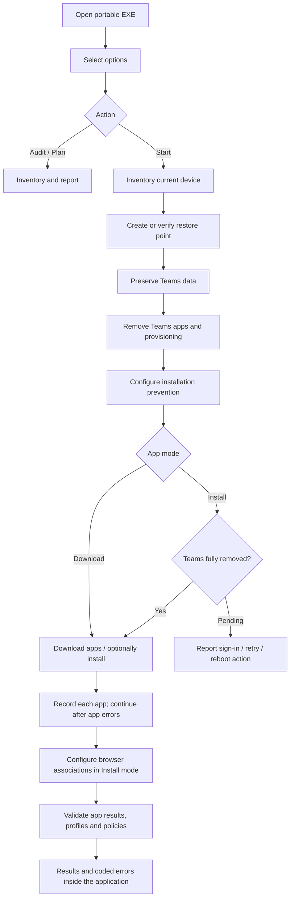

# TinnosDebloat-Win11

Windows 11 cleanup and workstation provisioning, with a restore point before deployment.

<div align="center">


</div>

<details>
<summary><strong>[Open/Close] Table of Contents</strong></summary>

- [📄 Description](#-description)
- [💡 Technologies](#-technologies)
- [⚙️ General Settings](#️-general-settings)
- [🚀 Usage](#-usage)
- [🛟 Restore Point](#-restore-point)
- [⚙️ Architecture](#️-architecture)
- [📁 Repository Structure](#-repository-structure)
- [🔎 Results](#-results)
- [Error codes](docs/ERROR_CODES.md)
- [🔧 Build and Test](#-build-and-test)
- [🚧 Versions](#-versions)
- [🔗 References](#-references)

</details>

---

## 📄 Description

**TinnosDebloat-Win11** prepares an existing Windows 11 installation for work. It
removes Microsoft Teams, downloads Microsoft 365 Apps for Business, Chrome and
Google Drive, and checks the resulting state. App installation is optional; a
failed app is reported and skipped while the others continue. It works on the running Windows
installation; no Windows reinstall or custom image is needed.

This project was created with assistance from OpenAI Codex.

The name references the Lost City of Tinnos in *Tomb Raider III: Adventures of Lara
Croft*. We are clearing annoying things out of Windows, much like dealing with
those green flying enemies in Tinnos: the **Tinnos Wasps**. The stage's giant wasps
are described in [Stella's Tinnos walkthrough](https://tombraiders.net/stella/walks/TR3walk/A3-tinnos.html).
This is an independent utility with no affiliation with the game or its publishers.

The current cleanup scope is Teams and its installation paths. This tool does
not remove an arbitrary list of Windows apps, disable Windows Update or Defender,
or erase personal documents.


| Component | Behavior |
| --- | --- |
| Microsoft 365 Apps for Business | Official ODT, `O365BusinessRetail`, 64-bit, Current Channel |
| Word, Excel, PowerPoint, classic Outlook, OneNote | Included in Office media; verified on the device when installation is selected |
| Access | Optional selection |
| Teams | Always excluded; new, classic, personal, machine-wide and provisioned variants checked |
| OneDrive | Excluded from Office when selected; existing standalone OneDrive and its documents are preserved |
| New Outlook | Excluded from Office when selected; classic Outlook remains required |
| Chrome | Official Google Enterprise MSI; browser associations configured only in Install mode |
| Google Drive for desktop | Official Google installer; downloaded by default, silent installation optional |

## 💡 Technologies

| Layer | Technology |
| --- | --- |
| Desktop interface | C# / Windows Forms / .NET Framework 4.x |
| Deployment engine | Windows PowerShell 5.1, 64-bit |
| Office deployment | Microsoft's Office Deployment Tool |
| Teams removal | Official bootstrapper, Appx/MSIX servicing, supported legacy uninstallers |
| Recovery | Windows System Restore |
| Results | In-app results, mapped error codes, live log and download SHA-256 hashes |

The portable executable embeds its PowerShell files. Target devices do not need
Git, Python, a development SDK, or this source repository.

## ⚙️ General Settings

### Requirements

- Windows 11 x64, administrator access and an internet connection.
- Windows PowerShell 5.1 and .NET Framework 4.x supplied with Windows.
- Windows System Restore available and permitted by organization policy.
- Downloads need no Microsoft/Google account sign-in or Office activation.
- Using Office later requires an appropriate Microsoft 365 Apps for Business license.

### Interface selections

The window groups selections into **App action** and **Office options**.
Office is always **Microsoft 365 Apps for Business, PT-BR, 64-bit**.
The only action buttons are **Start** and **Details**.

| Button | Default | Meaning |
| --- | --- | --- |
| Download only | Selected | Save app installers/media without installing the apps or changing browser defaults |
| Download + install | Off | Download app files and attempt silent installation |
| Include Access | Off | Include Microsoft Access |
| Exclude OneDrive | Selected | Exclude OneDrive from the Office deployment |
| Exclude new Outlook | Selected | Exclude the new Outlook app from Office |

Gold selections are enabled. Office language is fixed to Portuguese (Brazil);
there is no language selector. The Office edition, Teams exclusion, 64-bit
architecture and restore-point step are automatic.
The GUI uses Current Channel; administrators can select another supported update
channel in JSON for command-line deployment.

Leave **Download only** selected to save the files, or choose **Download + install**
to attempt silent app installation. These modes are mutually exclusive. **Start**
runs the selected action. **Details** expands the Results, Errors and Log tabs.
Teams cleanup and restore-point handling still run with either action;
Download only applies to Office, Chrome and Drive, not to cleanup.
An app download/install error never cancels attempts for the remaining apps.

### Official downloads

ODT is resolved automatically from [Microsoft Download Center, product 49117](https://www.microsoft.com/en-us/download/details.aspx?id=49117).
There is no installer picker or configurable mirror. The engine extracts the
official archive and verifies Microsoft's signature on both the archive and
`setup.exe`. If the page cannot be reached (including a `www.microsoft.com` DNS
failure), it tries the official `download.microsoft.com` archive link verified
for this release on 2026-11-04. The fallback is ODT 16.0.20430.20146; page-based
discovery is preferred for the current version. Neither source requires sign-in.
An invalid signature is rejected.

Installer transfers try PowerShell `Invoke-WebRequest`, then Windows' inbox
`curl.exe`, with HTTPS-only transfers, timeouts, nonempty-file checks and vendor
signature verification. Failed or unsigned responses never become final installer
files. A different downloader does not repair an unavailable internet connection
or broken DNS; those failures remain explicit in Details and the next app is tried.

The [Teams bootstrapper](https://go.microsoft.com/fwlink/?linkid=2243204&clcid=0x409)
is used exclusively with uninstall arguments `-x -m`. Chrome and Drive come from
Google's official `dl.google.com` endpoints and must pass Google signature checks.
ODT downloads Office files before installation. No tools are taken from third-party
script collections or unofficial mirrors.

---

## 🚀 Usage

### Portable application

1. Copy [tinnosdebloat-win11.exe](tinnosdebloat-win11.exe?raw=true) to the target device.
2. Open it and approve the Windows administrator request.
3. Choose the app action and optional Office components. Office language is always PT-BR.
4. Select **Start** to run cleanup and the chosen download/install action.
5. Select **Details** to view results, error codes and the live log inside the application.

Opening the app does not deploy anything. Closing is blocked while an operation
is running, so installers are not interrupted by closing the window.

The executable is unsigned. Sign release binaries and scripts with your normal
publisher certificate where managed distribution requires it. This build has been
compiled and tested without a live deployment; validate on Windows 11 test devices
before broad rollout.

### Unattended execution

From an already elevated management process:

```powershell
$run = Start-Process .\tinnosdebloat-win11.exe `
    -ArgumentList '--mode Deploy' -Wait -PassThru
$run.ExitCode
```

Defaults are embedded. For administrator customization, copy `config.example.json`:

```powershell
Start-Process .\tinnosdebloat-win11.exe `
    -ArgumentList '--mode Deploy --config "C:\Deployment\config.json"' `
    -Wait -PassThru
```

Modes are `Audit`, `Plan` and `Deploy`. An optional `--output <folder>` changes the
working-file location. These advanced modes remain available through the command
line; the GUI has no Audit button. Plan generates XML without deploying software.
The Business product and `"Languages": ["pt-br"]` are fixed; other languages,
unknown fields, license keys and custom installer URLs are rejected.

`"AppMode": "Download"` is the default. Set `"AppMode": "Install"` to attempt app
installation. Office download mode runs ODT `/download` and verifies the media;
it never runs `/configure`. Office data is saved under `OfficeMedia`, and Chrome
and Drive installers are saved beside the generated Office XML. If moving Office
media to another folder or device for later installation, update the XML's absolute
`SourcePath` to the copied `OfficeMedia` folder.

### Execution policy and activation

The launcher and employee cleanup helper use `-ExecutionPolicy Bypass` only for
their own PowerShell processes. They do not change CurrentUser or LocalMachine
execution policy. **Group Policy MachinePolicy/UserPolicy still take precedence**.
A centrally blocked or AllSigned-only deployment requires organization-approved
script signing or management configuration. The tool reports the block.

The deployment never signs in, requests credentials, activates Office or queries
the employee's license. Details shows activation as **Deferred**, which does not
block downloads or installation. There is no key, password or licensing bypass.
An employee may activate Office later using their licensed account. The separate
`Check-OfficeActivation.ps1` remains an optional manual diagnostic; deployment
does not invoke it.

## 🛟 Restore Point

**Start** attempts to create and verify a Windows restore point before application
removal, policy changes or installation. System protection is enabled on the
Windows system drive using the supported cmdlet when policy permits it.
Policy-disabled restore is reported and is not overridden.

Windows normally limits `Checkpoint-Computer` to one point per day. If Windows
explicitly throttles creation, a verified point less than 24 hours old can be
used, recording `ReusedRecent`, its sequence and timestamp. That older point does
not represent the exact state immediately before this run. A fresh point is
reported as `Created`. If neither is available, deployment stops before removing
or installing applications and reports the pending action.

Restore points are not backups of personal documents. Before Teams uninstall,
known local Teams data stores are separately copied to an administrator/SYSTEM-only
`PreservedTeamsData` directory. Locked data, unreadable profiles, running Teams and
redirected data stores block removal. No recursive deletion of Microsoft folders,
synchronized files, Desktop documents or Downloads is performed.

## ⚙️ Architecture



Matching Office installations are skipped. Product, bitness, apps, languages,
channel and exclusions must all match. Incompatible Office installations and
central update-policy conflicts require administrator remediation. Documents and
applications are not force-closed.

Matching-install checks apply only to Install mode. Download mode can prepare
Office media regardless of the installed Office edition. Pending Teams cleanup
blocks application installation; downloading the app files can continue without
claiming Teams is absent. Restore-point and centrally managed policy blockers
remain enforced.

Classic Teams profiles use limited interactive tasks named
`TinnosDebloat-Win11-RemoveTeams-<SID>`, without saved credentials. Offline profiles
may need a logon before cleanup finishes. Rerun Start afterward to continue.
Registered tasks or zero uninstall exit codes do not prove removal. Inventory
covers nonspecial local Windows profiles and all-user packages; detached or
remote profile containers require an audit when attached.

GPO/Intune settings are preserved and conflicts reported. The Office prevention
policy covers the Office installation/update path. Separate Intune, Store or
tenant app assignments must also be reviewed centrally. Chrome's supported default
policy applies at sign-in; existing `UserChoice` hashes are never modified.

## 📁 Repository Structure

```text
tinnosdebloat-win11/
├── tinnosdebloat-win11.exe       # Portable application
├── tinnosdebloat-win11.exe.sha256
├── Build.ps1                   # Uses Windows' C# compiler
├── Invoke-Provisioning.ps1
├── Invoke-UserCleanup.ps1
├── Check-OfficeActivation.ps1
├── Provisioning.psm1
├── config.example.json
├── error-codes.json             # Shared error catalog
├── src/
│   ├── Program.cs
│   └── app.manifest
├── tests/
│   └── Run-Tests.ps1
├── docs/
│   ├── interface.png
│   └── ERROR_CODES.md
└── README.md
```

Only the `.exe` is needed on target devices. Source and tests remain in the
repository for review and rebuilding.

## 🔎 Results

**Details** displays the current run inside the application:

- **Results:** restore point, individual applications, cleanup and policy checks.
- **Errors:** stable `TNO-xxx` codes, the original message, recovery action and native exit code when available.
- **Log:** live execution output and additional notes.

Results and the live log stay in memory and are lost when the application closes.
The tool does not write `report.html`, `report.json` or `launcher.log`.
For troubleshooting, use the [error-code reference](docs/ERROR_CODES.md).
For example, `TNO-300` identifies DNS resolution failure and `TNO-400` identifies
a vendor installer/uninstaller failure; the native exit code gives further detail.

Downloaded installers, Office media/XML, extracted scripts, configuration and
pending cleanup-task dependencies still need working files under
`C:\ProgramData\TinnosDebloat-Win11\Runs\<run-id>\Work` and its parent run directory.
Protected `PreservedTeamsData` is retained when user data needs preservation.
Windows and vendor tools may create their own system logs. Reports left by older
versions are not automatically deleted.

| Exit code | Result |
| --- | --- |
| `0` | Passed audit/deployment, or generated plan; inspect mode and checks |
| `1` | Failure, unreadable inventory or policy conflict |
| `2` | Cleanup checks passed, but some app operations failed or were skipped (`CompletedWithIssues`) |
| `3010` | Pending reboot, profile logon, restore availability or retry; read Details |

In-memory results include restore-point outcomes, before/after inventory, policies, remaining
Teams components, individual app outcomes and deferred activation. Inaccessible
relevant inventory prevents a claim of complete removal. Complete provisioning
does not imply that the employee's Office account is activated.

The Applications summary distinguishes `Downloaded`, `Installed`, `AlreadyInstalled`
and `Failed`. Required cleanup checks are separated from app observations.
Downloading an installer never reports its app as installed. Failed optional apps
produce `CompletedWithIssues` only when the required cleanup checks pass; remaining
Teams, unreadable profiles or policy conflicts cannot be hidden by skipping apps.

Keep working directories while tasks are pending. They hold task dependencies and
may contain preserved Teams data/authentication material; apply your retention
rules. Never commit device reports or preserved data to GitHub. `.gitignore`
excludes runtime paths, local configuration and logs.

## 🔧 Build and Test

No NuGet packages or third-party build tools are required:

```powershell
.\Build.ps1
.\tests\Run-Tests.ps1
```

Tests inspect embedded sources, manifest, arguments, configuration, XML, absence
criteria, restore-point failures and operation ordering using temporary files and
mocks. They do not install software, change execution policies or create restore
points. The preview is rendered from the real form without starting deployment.

## 🚧 Versions

<details>
<summary><strong>[See/Hide] Version 2.2.0 — Results inside the app</strong></summary>

- Fixed PT-BR Office configuration and removed language selectors.
- Only Start and Details action buttons, with Results, Errors and Log tabs.
- In-memory results replace saved deployment reports and launcher logs.
- Shared error catalog with recovery actions and native installer exit codes.
- Updated interface screenshot, tests and Tinnos Wasps naming reference.

</details>

<details>
<summary><strong>[See/Hide] Version 2.1.0 — Download and continue</strong></summary>

- Download-only default with optional app installation.
- Grouped action, language and Office settings; explicit mode choices and a clear primary action.
- Independent Office, Chrome and Drive operations; failures are skipped and reported.
- Official Microsoft archive fallback for unavailable Download Center discovery.
- PowerShell transfers with a Windows curl fallback and vendor signature checks.
- No automatic sign-in, activation or license-status query.
- Clear app outcomes and `CompletedWithIssues` status.

</details>

<details>
<summary><strong>[See/Hide] Version 2.0.0 — Tinnos</strong></summary>

- Independent project identity and portable executable.
- Minimal selection buttons with expandable execution details.
- Microsoft 365 Apps for Business and automatic official ODT downloads.
- Restore point verified before deployment changes.
- Process-scoped PowerShell setting for packaged scripts.
- Teams exclusion, data preservation, all-user checks and pending-action reports.

</details>

## 🔗 References

- [Microsoft Office Deployment Tool](https://www.microsoft.com/en-us/download/details.aspx?id=49117)
- [ODT XML configuration](https://learn.microsoft.com/en-us/microsoft-365-apps/deploy/office-deployment-tool-configuration-options)
- [Teams removal](https://learn.microsoft.com/en-us/microsoftteams/teams-client-uninstall)
- [Prevent Teams installation with Office](https://learn.microsoft.com/en-us/microsoft-365-apps/deploy/teams-install)
- [Checkpoint-Computer limits](https://learn.microsoft.com/en-us/powershell/module/microsoft.powershell.management/checkpoint-computer?view=powershell-5.1)
- [PowerShell execution-policy precedence](https://learn.microsoft.com/en-us/powershell/module/microsoft.powershell.core/about/about_execution_policies?view=powershell-5.1)
- [Microsoft 365 activation diagnostics](https://learn.microsoft.com/en-us/microsoft-365-apps/licensing-activation/vnextdiag)
- [Google Drive deployment](https://knowledge.workspace.google.com/admin/drive/set-up-drive-for-desktop-for-your-organization)
- [Windows default associations](https://learn.microsoft.com/en-us/windows/client-management/mdm/policy-csp-applicationdefaults)

---

Developed by [Vitória Peçanha](https://github.com/vitoriape).
